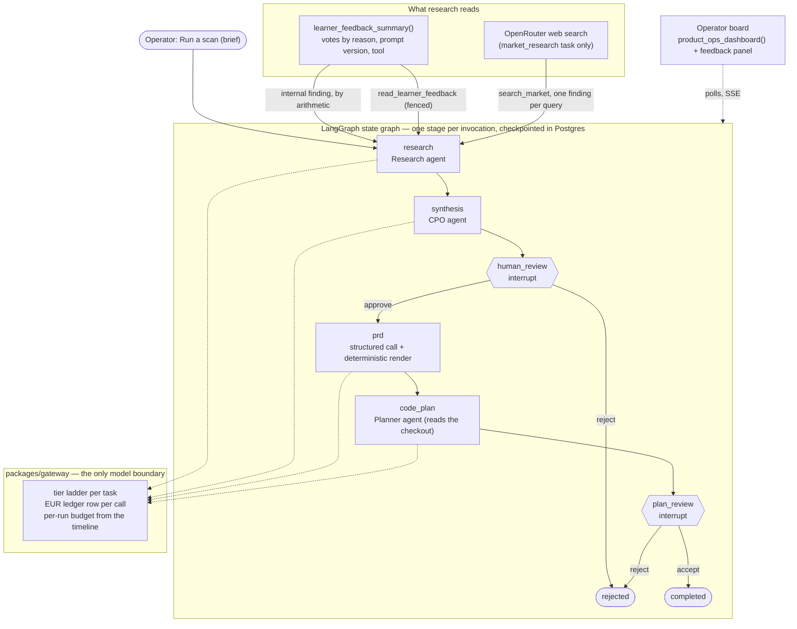

# Deutsch Partner
An AI German-conversation tutor for English speakers, from absolute beginner to
B1. A pnpm and Turborepo workspace: two Next.js apps and a Node worker over
shared packages, TypeScript throughout, Supabase and OpenRouter.

You talk to it in German. It replies at your level, corrects you in the way your
level can use, and keeps track of what you know — seventy mini-levels from a
first *hallo* to holding an opinion. When four in five of your recent messages
come back error-free, it moves you up on its own; say *weiter* (or press the
button) to move on early.

What you say is never stored. A conversation lives in your browser and dies
with the tab; the database keeps only what the practice meant — your mistakes,
your vocabulary, and a per-level score.

## What it does

- **A tutor that talks** (`/chat`). German conversation at your level, streamed,
  with corrections your level can use, retrieval over a hand-authored knowledge
  corpus, and long-term memory of your goals and interests. Speak to it and have
  it read back to you; the speech model first, your device's own voice as a real
  fallback.
- **A curriculum, not a model's opinion** (`/curriculum`). Seventy mini-levels,
  420 words and 86 grammar patterns as data. Progression, mastery, review
  scheduling and recommendations are pure functions over your own record.
- **A trainer that runs the drills** (`/trainer`). A tool-using agent that opens
  a session with an agenda — due words, recurring mistakes, the level's grammar
  and culture notes, today's simple-German news — quizzes one item at a time,
  judges the answer, records the outcome through the deterministic review
  engine, and shows every tool it used.
- **A trainer that learns from you.** Rate any reply, or just ask for a change,
  and closed-set dials move: how much it explains, how hard it pushes, how long
  a sitting runs, what the agenda leans towards, whether it ends on the news.
  Disputed corrections make it check a rule before it corrects. Everything it
  learned is on the settings page with a button that forgets it — next to a
  choice that button leaves alone: a friendly trainer or a strict one.
- **Scenarios and comprehensions** (`/scenarios`). Fifty practice items found in
  your own words by vector search: dialogues played as roleplay, passages
  answered as a quiz.
- **Review and progress** (`/review`, `/dashboard`). What is due, what is weak,
  what keeps going wrong, and the per-level score that decides when you move.
- **An operator app of its own** (`apps/ops`). On its own origin, behind a
  password and an authenticator code: euro spend by task and model, and the AI
  Product Ops board described below — which opens every scan with what learners
  said about the trainer. It records jobs; a worker runs them.

## Walkthrough

[](https://youtu.be/<YOUTUBE_ID>)

Five minutes, screen only: sixty seconds of the product, then the gateway,
retrieval and the tests that guard the boundaries.

## Documentation

| Document | What it answers |
| --- | --- |
| [Product flow](docs/product-flow.md) | What a learner does, and what happens when they do it |
| [Architecture](docs/architecture.md) | How the code is laid out and why the boundaries are where they are |
| [How the pieces work](docs/topics.md) | Plain-language explanations of RAG, prompting, vector search, Next.js and the rest |
| [Operations](docs/operations.md) | Environment, ingestion, cost, and what to check when something breaks |
| [Product ops agents](docs/product-ops-agents.md) | The multi-agent workflow: graph, gates, agents, tools, what flows where |
| [Deployment](docs/deployment.md) | The three containers, the pipelines, the manifests, the runbooks |

The specifications this was built against are in
[`.claude/docs/`](.claude/docs/); the four above describe what was actually
built, including what was not.

## Getting started

```bash
cp apps/learner/.env.example apps/learner/.env.local   # then fill in the Supabase values
cp apps/ops/.env.example apps/ops/.env.local
cp apps/worker/.env.example apps/worker/.env.local
pnpm install
pnpm dev                     # learner on :3000, operator app on :3001, worker polling
```

```
apps/learner   apps/ops   apps/worker          the three deployables
packages/      domain, db, gateway, prompts, product-ops, learning, auth, env,
               observability, ui, corpus, config, test-support, security-tests
```

## Everyday commands

| Command | What it does |
| --- | --- |
| `pnpm dev` | All three deployables, with hot reload |
| `pnpm verify` | Typecheck, lint, every test and every build, for every workspace |
| `pnpm test:unit` | Unit and component tests (jsdom) |
| `pnpm test:db` | Schema and RLS tests against real Postgres, in-process via PGlite |
| `pnpm test:e2e` | Playwright, against a production build on port 3100 |
| `pnpm db:push` | Applies pending migrations to the linked Supabase project |
| `pnpm db:seed` | Re-applies the generated curriculum and vocabulary seeds |
| `pnpm db:advisors` | Supabase security and performance linters |
| `pnpm ingest` | Embeds the knowledge corpus. Safe to re-run; does nothing if nothing changed |
| `pnpm ingest --dry-run` | Reports what would be ingested, without a provider or a key |
| `pnpm scenarios:ingest` | Embeds the scenario corpus (Python, via uv). Same idempotence contract, same `--dry-run` |
| `pnpm scenarios:eval` | Evaluates scenario retrieval: hit@5, then ragas metrics via a judge model |
| `pnpm scenarios:test` | The Python parser and ingestion-plan tests |

## The curriculum

Three files are the single source of truth. [`curriculum.ts`](packages/learning/src/curriculum.ts)
holds the seventy mini-levels — theme, topic, target words, grammar, functions.
[`lexicon.ts`](packages/learning/src/lexicon.ts) holds one dictionary entry for each
of the 420 target words. [`grammar-seeds.ts`](packages/learning/src/grammar-seeds.ts)
holds the 86 grammar patterns, each with the mistakes the tutor quotes when it
corrects someone. Goals, thresholds, frequency bands and difficulty are derived
from those, so nothing can drift out of step with its own content.

The database needs the same rows — a learner's state points at a mini-level,
their vocabulary progress at a word, their errors at a pattern — so all three
seed migrations are generated rather than maintained beside them:

```bash
pnpm curriculum:generate   # rewrites the three generated seed migrations
pnpm db:seed               # re-applies them to the linked project
```

Tests compare each committed migration against a fresh render, so editing one
without the other fails rather than drifting quietly.

`db:seed` exists because a migration runs once. The seeds are declarative and
idempotent, so a fresh database gets them from `db push`, while one that already
applied an earlier version gets the update from `db:seed`.

## A fixture learner

```bash
pnpm dummy:user
```

Creates a confirmed account on the project `.env.local` points at, signs in with
the publishable key, completes onboarding through the same RPC the form calls,
and prints the credentials. The password is generated on each run unless
`DEV_SEED_PASSWORD` is set; nothing usable is committed. The address must sit on
a reserved domain, so a fixture account can never mail a real person.

With `DEV_SEED_EMAIL` and `DEV_SEED_PASSWORD` set, `pnpm test:e2e` also runs the
fixture sign-in spec; without them it skips.

This creates a real account on a real project. Delete it before the project is
reachable by anyone but you.

## Three things that shape the codebase

**A tutor that costs more per learner than it earns is not a product.** Every
model call is routed to the cheapest tier that can do the job, capped in tokens
before it is sent, and written to a euro ledger. A typical learner turn costs
about €0.0064. See [operations](docs/operations.md#cost).

**The model is not the curriculum.** Mini-level progression, mastery scores,
review scheduling and recommendations are pure functions over the learner's own
record — cheaper, reproducible, and explainable without asking a model to
justify itself.

**Model output is never trusted.** Every structured reply is validated, salvaged
where that is safe, and discarded where it is not. The safe answer when an
evaluation cannot be read is to write nothing.

## Scenarios & Comprehensions

A second corpus of fifty hand-authored practice items under **/scenarios**,
searchable in a learner's own words ("I want to practice ordering food at a
restaurant"). Each item is one of exactly two types: a **dialogue** — a
German script with English translations, practised as an AI roleplay in the
chat — or a **comprehension** — a German passage (reading text, telephone
menu or train announcement) answered as a quiz, graded by a string check in
the browser at no model cost. Search embeds the query through the gateway
(ledgered, budgeted, cached) and matches by vector similarity via the
`search_scenarios` database function, filterable to dialogues or
comprehensions. Every result carries a source citation — the dataset document
and item it was parsed from — through the API response onto the card. The
corpus is parsed and embedded by the Python tooling in
[`apps/learner/scripts/scenarios/`](apps/learner/scripts/scenarios/), which also carries the ragas
retrieval evaluation.

## Product ops: agents that propose, people that decide

An operator runs a market scan; the pipeline researches, proposes a feature,
waits for approval, writes a PRD, plans the implementation, and waits again.
The plan is the deliverable. The stages are nodes of a LangGraph state graph,
the two human gates are graph interrupts, and the judgement inside a node is
delegated to a tool-using LangChain agent whose tools are the only doors it has.
Nothing here runs in a web process: the operator app records a job and a
worker drives the run, one stage per claim, checkpointed in Postgres. The
implementation stages exist and are tested but no review leads into them.



Each agent is `createAgent` over a model the gateway built for the agent's task,
under a fixed middleware stack: the run's euro budget reconstructed from its own
timeline, per-run caps on tool and model calls, every tool result fenced as
untrusted with its delimiter escaped, a progress event per finished call carrying
the tool's name and outcome and never its arguments, and summarisation of older
tool output near the input ceiling. What a run records is what the tools wrote,
never the model's account of what it did.

| Agent | Stage | Tools | Tier |
| --- | --- | --- | --- |
| Research | research | `read_learner_feedback`, `search_market` | cheap, with web search |
| CPO | synthesis | `read_findings`, `list_prior_proposals`, `search_internal_docs` | reasoning |
| Planner | code_plan | `read_prd`, `list_files`, `read_file`, `search_code` | reasoning |
| Coder | implementation (unreachable) | `read_file`, `propose_edit` | reasoning |

The learner feedback loop closes here. Every vote under a trainer reply is stored
with its reasons and the prompt version the reply was written under. A database
function aggregates them for the operator, the research stage records the
aggregate as its first finding before it searches the web, and the research agent
reads the same document — notes fenced as learners' words — so a proposal weighs
what this product's learners flagged against what forums say about learners in
general. [The full walkthrough](docs/product-ops-agents.md) has the stage graph,
the checkpoint shape, the validation layer and the liveness signal.

## Where it runs

| Deployable | Host | Address |
| --- | --- | --- |
| `apps/learner` | Vercel, root directory `apps/learner`, Node 22 | <https://deutsch-partner.vercel.app> |
| `apps/worker` | Railway, one always-on instance built from `docker/worker.Dockerfile` at the repository root | none: it polls and serves no traffic |
| `apps/ops` | not deployed yet | — |
| the database | one hosted Supabase project; migrations land through `deploy-db.yml` | — |

The three deployables never call each other. Each talks only to the Supabase
project and to OpenRouter, so any one of them can be redeployed, moved or
switched off without the others noticing. The learner is fully usable with no
worker running; pg_cron keeps queueing the scheduled jobs, and a worker deployed
later drains the backlog.

Two values must be identical everywhere or the ledger and audit rows stop
joining: the Supabase URL and secret key, and `LOG_PSEUDONYM_SALT`. Every
deployable sets `APP_URL` to the learner's address above — a full URL with its
scheme, or the env schema refuses to boot — but only so OpenRouter labels the
spend; nothing ever fetches from it.

On Railway the health check path is `/healthz`; it answers 503 until the first
poll of the queue has completed, so a failing check right after a deploy is the
worker waiting on Supabase, not a crash. The Dockerfile carries no BuildKit
cache mounts and no `VOLUME` because Railway's validator rejects both. The
Cloud Run and GKE routes, the pipelines and the runbooks are in
[docs/deployment.md](docs/deployment.md).

## Status

Every phase of the build specification is implemented, and the monolith has
been split into three independently deployable containers over shared
packages, with `pnpm verify` green across the workspace and 44 migrations for
the linked project.

Every model call — chat, the trainer, the product-ops agents, embeddings and
speech — rides OpenRouter through the one gateway. The embedding pipelines have
run for real against the linked project, and product ops has run against a real
provider as far as an approved proposal; the agents and the trainer are tested
against scripted models. [Architecture](docs/architecture.md#what-is-not-built)
lists what is deliberately not built.

The database is the only meeting point. The learner writes learner state and its own model spend. The operator app only enqueues rows. pg_cron enqueues the scheduled jobs on its own. The worker polls the same table and drains whatever is there. Nothing here needs another app's hostname.


