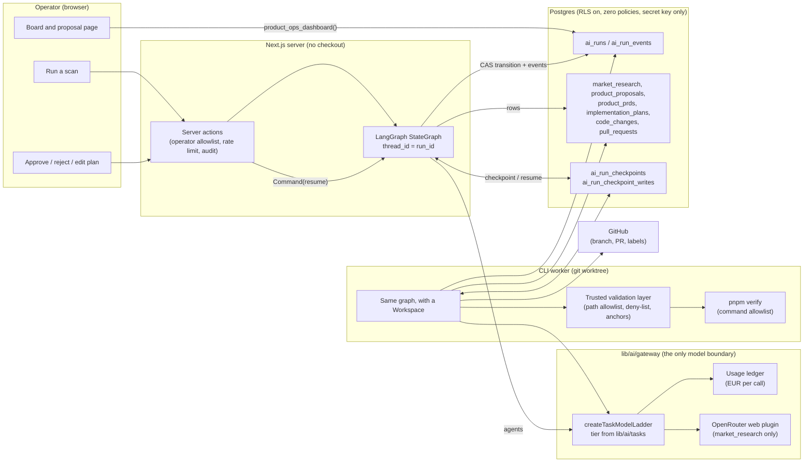
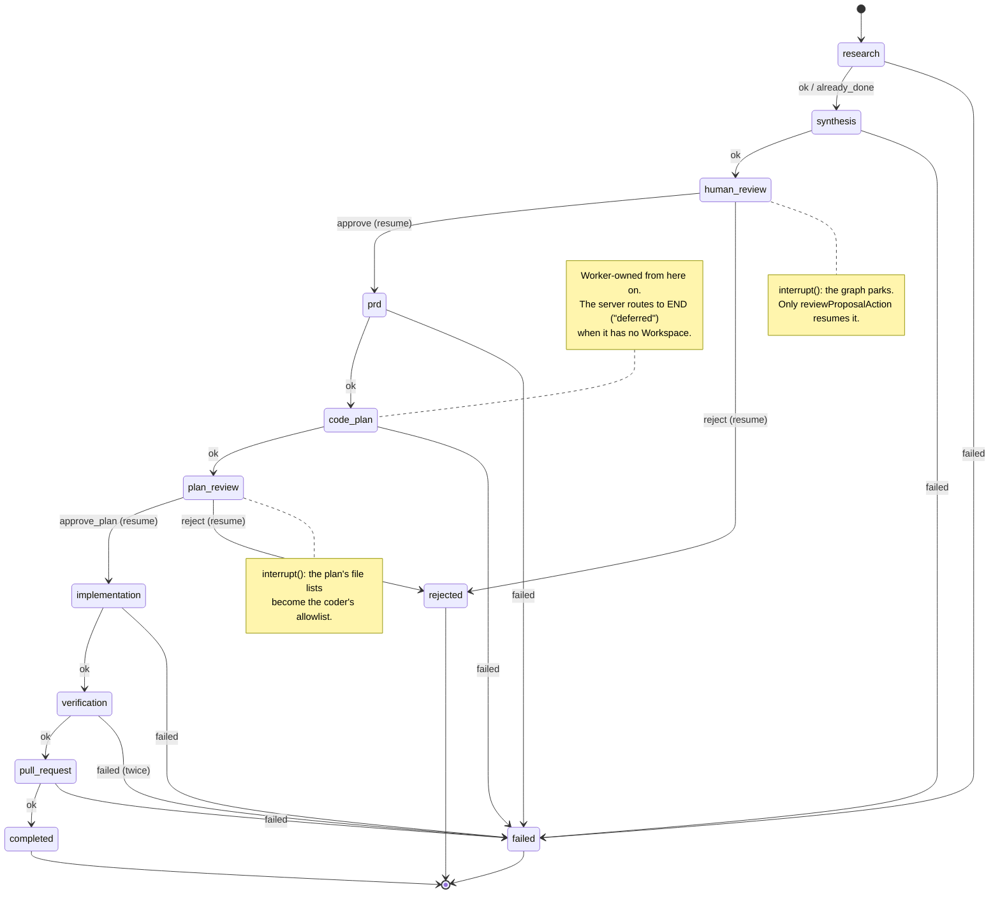
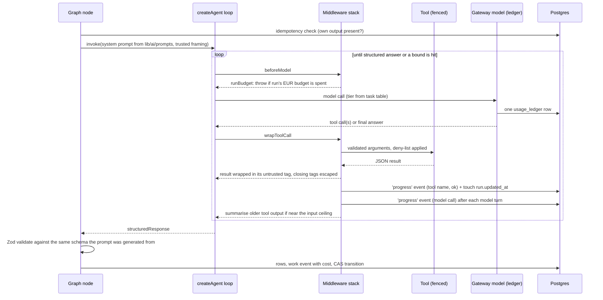
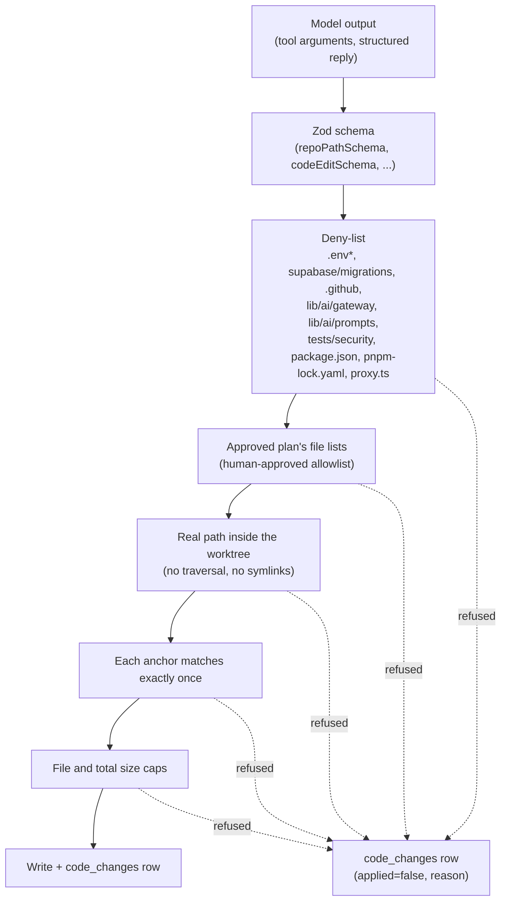

# Product Ops: how the multi-agent workflow works

This document describes the AI Product Ops workflow as built: a LangGraph state
graph whose nodes are the pipeline's stages, two human gates implemented as graph
interrupts, and four tool-using LangChain agents doing the judgement-bearing work
inside those nodes. It is the companion to `.claude/docs/product-ops-spec.md`,
which says what must hold; this says how data moves.

## 1. The shape in one diagram

Three processes touch a run. The browser only ever calls server actions. The
server drives the stages that need no working tree. The CLI worker drives the four
that do, using the same graph with a `Workspace` supplied. All three read and write
the same Postgres rows, and only the gateway ever reaches a model.

## 2. The stage graph

Every edge is the pure `nextStage` function from `domain/product-ops.ts`. No model
ever chooses the next node. A node:

1. checks for its own output first and adopts it if present (idempotency),
2. does its work, agent or deterministic,
3. writes a work event with its cost, then
4. compare-and-sets the run's stage in Postgres. A refused CAS ends the graph with
   `raced`; the checkpoint is a cache of progress and the row is the authority.

The graph checkpoints after every node into `ai_run_checkpoints`, keyed by the run
id as the thread. Killing the process between two nodes loses nothing. Checkpoints
carry identifiers and control flow only; a proposal, a PRD or a plan is always
re-read from its own table.

## 3. What flows through each node

| Node | Owner | Reads | Agent or function | Writes |
| --- | --- | --- | --- | --- |
| research | server | brief, learner feedback aggregate | Deterministic internal finding from the aggregate (no model call), then **Research agent**: `read_learner_feedback`, `search_market` | `market_research` rows, progress events |
| synthesis | server | findings, prior proposals, corpus | **CPO agent**: `read_findings`, `list_prior_proposals`, `search_internal_docs` | one `product_proposals` row |
| human_review | operator | proposal page | `interrupt()` | `proposal_reviews` row, transition |
| prd | server | approved proposal | `prdSections` structured call + deterministic render | `product_prds` row, `.ai/prds/<id>.md` projection |
| code_plan | worker | PRD, worktree | **Planner agent**: `read_prd`, `list_files`, `read_file`, `search_code` | `implementation_plans` row (denied paths reported) |
| plan_review | operator | plan file lists | `interrupt()`; operator may drop files before approving | plan status `approved`, transition |
| implementation | worker | approved plan, PRD | **Coder agent**: `read_file`, `propose_edit` through the applier | `code_changes` rows, commits on the branch |
| verification | worker | branch | `pnpm verify` through the command allowlist; one coder repair pass on failure | `code_changes` rows for the repair |
| pull_request | worker | proposal, PRD | GitHub client: push, find-or-open PR, label | `pull_requests` row |

**Where the learner feedback comes from.** Every vote a learner casts under a
trainer reply lands in `trainer_feedback` with its reasons, the reply's tool
receipt and the trainer prompt version it was written under. The function
`learner_feedback_summary` aggregates the last thirty days — by verdict, reason,
prompt version and tool, with the newest notes — and only the secret-key client
may execute it. The research stage turns that document into one finding of
`sourceType: "internal"` by arithmetic (`lib/product-ops/feedback.ts`) and
records it before the first web search, so the CPO reads what this product's
learners flagged beside what the web says about learners in general. Fewer than
five votes in the window is no finding rather than a trend. The research agent
also reads the same document through `read_learner_feedback`, fenced as
`learner_feedback` because the notes in it are learners' words. The same
aggregate is drawn for the operator on the scans and runs page, below the
runs it feeds.

## 4. Inside an agent node

The middleware stack, in order:

| Middleware | Bound it enforces |
| --- | --- |
| `runBudgetMiddleware` | The run's euro budget, reconstructed from the run's own events and handed in as the turn. Stops the next model call, not the current one. |
| `cacheMarksMiddleware` | Anthropic-style prompt-cache breakpoints on the system prompt and the trusted request, only for a candidate the registry says reads them. The tool transcript after the request is not marked, because whether the router forwards a mark on a tool result is undocumented and a refused request would fail the stage. A `wrapModelCall` hook, so the runtime unwraps the framework's `MiddlewareError` before classifying what a model threw. |
| `toolCallLimitMiddleware` | Per-run cap on tool calls, with `exitBehavior: "continue"`: a turn that asks for more calls than remain gets the ones that fit and an error message for the rest, and the loop goes on to answer. Set to throw, one batch of a dozen parallel reads ended a whole planning stage before a single file was read. The model-call cap is the hard bound. |
| `modelCallLimitMiddleware` | Per-run cap on model calls, sitting above the tool cap as a second line. |
| `fencedToolResultsMiddleware` | Every tool result is wrapped in its untrusted tag (`web_results`, `market_research`, `repo_source`, `command_output`, `tool_result`) with angle brackets escaped. |
| `progressMiddleware` | Reports each finished tool call — name and success only — and each finished model call, as the bare fact of one. Never arguments, results or replies. Model calls are reported from `afterModel`, a node hook: the framework wraps anything thrown through `wrapModelCall` in its own error class, which would hide a 404 or a schema rejection from the loop. |
| `summarizationMiddleware` | Folds older tool output into a summary at 70 percent of the task's input ceiling, using the cheap-tier `productops.context_summary` task. |

The gateway's own ledger callback enforces the same euro ceiling from inside the
model, so the budget middleware is the first line and not the only one.

## 5. What the agents may and may not touch

The planner's `read_file`, `list_files` and `search_code` apply the deny-list before
the filesystem is asked anything, so an agent cannot even read a secret. The coder's
`read_file` goes through the applier and is therefore also limited to the approved
plan. Commands are an allowlist of argument arrays with no shell; the only free-text
argument is a commit message checked by its own rule.

## 6. Human in the loop

Two gates, both graph interrupts, both recorded as `proposal_reviews` rows before the
graph is resumed:

- **human_review**: approve (a PRD follows), reject (run ends as `rejected`),
  reprioritise or comment (recorded, run stays parked).
- **plan_review**: approve the plan, optionally after dropping files from its lists.
  What is approved is exactly what the coder may write. Reject ends the run.

A resume is `graph.invoke(new Command({ resume: decision }))` on the run's thread. If
a run stands at a gate with no checkpoint yet, the action performs the compare-and-set
transition directly and starts the graph fresh, which parks it again at the next gate.
Both paths converge on the same rows.

## 7. Liveness and cost

- Every stage transition and every agent tool or model call touches `ai_runs.updated_at`.
  The board calls a run stalled only when it has been quiet longer than the slowest
  stage, and polls only while something reports as working.
- A working run's card follows its timeline live: `GET /api/operations/product/:runId/events`
  streams the run's events as Server-Sent Events, read forward from Postgres on a short
  tick (`lib/api/product-ops-stream.ts`), and `components/operations/run-live-feed.tsx`
  puts each row into words. The feed refreshes the page when the run changes stage and
  closes when the run leaves the server's hands.
- The planning stage makes two calls. The planner agent names files, and those lists are
  the coding agent's path allowlist. Then `breakDownPlan` (`lib/product-ops/breakdown.ts`,
  task `productops.plan_breakdown`, reasoning tier) writes the engineering manager's half:
  requirements in build order and in phases, a t-shirt size (xs to xxxl) on each and on
  the whole, and technical guidance that names where the current stack is the wrong tool
  and weighs both sides. It reads the PRD, the file plan and the architecture notes as
  fenced knowledge, never a source file. The breakdown is stored in
  `implementation_plans.breakdown` (migration `20260910200000`), rendered on the proposal
  page and first in the copied Markdown. If only the breakdown fails, the plan is kept and
  a retry writes only the missing half.
- The agent graph's recursion limit is sized from the run's caps
  (`recursionLimitFor` in `lib/product-ops/agents/runtime.ts`): ten graph steps per
  allowed call, because every beforeModel and afterModel hook in the stack is a node
  and one tool round is eight or so steps, not two. The caps are the loop's real bounds;
  the recursion limit is the backstop behind them, and hitting it is reported as
  `tool_limit`. The first real planning run hit a limit sized for two steps per round
  after a handful of reads.
- The run ceilings in `RUN_BUDGET_EUR` were retuned from the first real trace: a scan
  costs about 0.06 to research, 0.13 to 0.26 to synthesise, 0.01 for the PRD, and the
  planner ran to 0.16 before the old 0.50 ceiling stopped it part-way. The planner is
  the expensive stage — each tool turn re-sends its transcript on the reasoning tier —
  so its stable prefix is cache-marked, its model-call cap is the tight one (12; tool
  calls are local reads and are allowed 30), its reads are bounded at 8000 characters
  (`MAX_PLANNER_READ_CHARS`; the coder keeps 24 000 because it needs anchors), and its
  prompt asks for at most four files per turn.
- A failed run can be tried again from the stage that failed: `retryRun` in
  `lib/product-ops/workflow.ts` reads the stage off the timeline, moves the run out of
  `failed` with the same compare-and-set, and the action drives the graph again from
  its entry node. The migration `20260910180000_product_ops_retry.sql` makes the
  transition function clear `error_code` and `completed_at` on leaving a terminal
  stage. The failed attempt's cost still counts against the run's ceiling.
- The mid tier sends `reasoning: { effort: "low" }` on every call. Its models think by
  default and its ceilings are 600 to 1000 tokens; the first real PRD call spent the
  whole ceiling thinking and was cut off twice. The cheap and nano tiers already sent
  "minimal" for the same reason.
- Model calls on the reasoning tier get a 90-second window and the other tiers 30 to 45
  (`CALL_TIMEOUT_MS` in the gateway's LangChain adapter). A timeout, a connection
  failure, a 429 or a 5xx walks the same-tier ladder like a missing endpoint does; only
  the last rung's failure ends the stage, as `timeout`. An answer the output ceiling cut
  off is repaired by asking for a shorter one; an answer that never came, by naming the
  answer tool.
- Every model call is one `usage_ledger` row tagged with its `productops.*` task, so
  operator spend appears on the existing cost dashboard broken down by task.
- A run's spend is the sum of the `costEur` on its events. Each invocation reconstructs
  it, and a run with nothing left is failed before any model call.

## 8. Where things live

| Concern | Path |
| --- | --- |
| Stage machine, schemas, deny-list | `domain/product-ops.ts` |
| Graph, checkpoint saver, drive/resume | `lib/product-ops/graph/` |
| Agent runtime, middleware, tools | `lib/product-ops/agents/` |
| Agent prompts and tool descriptions | `lib/ai/prompts/product-ops-agents.ts` |
| Task tiers and ceilings | `lib/ai/tasks.ts` |
| LangChain model over the gateway | `lib/ai/gateway/langchain-model.ts` |
| Trusted validation layer | `lib/product-ops/apply.ts` |
| Command allowlist | `lib/product-ops/commands.ts` |
| Worktree, browser, GitHub | `lib/product-ops/workspace.ts`, `lib/github/client.ts` |
| Repository over the eleven tables | `repositories/product-ops-repository.ts` |
| Operator pages and actions | `app/(app)/operations/product/` |
| CLI worker | `scripts/product-implement.ts` |
