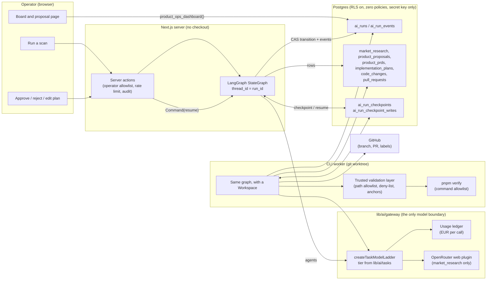
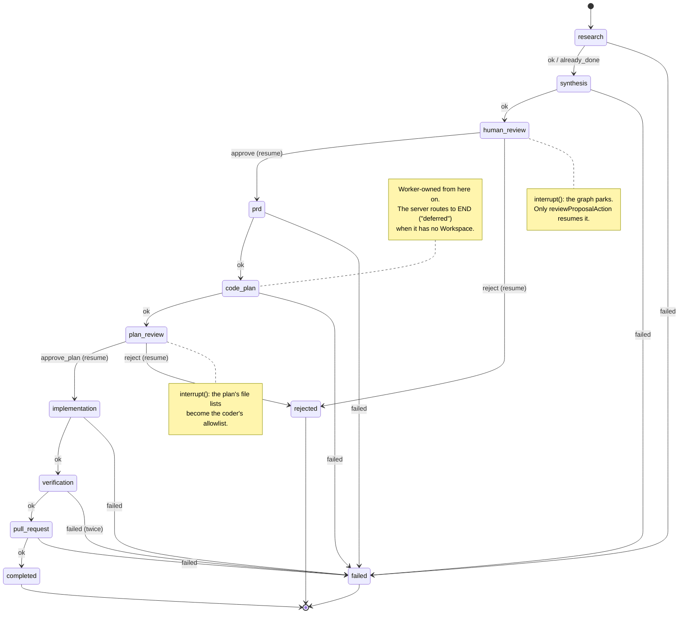
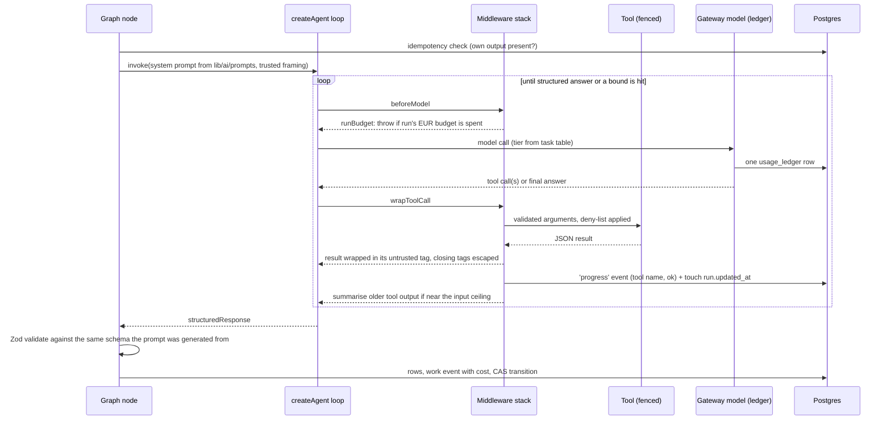
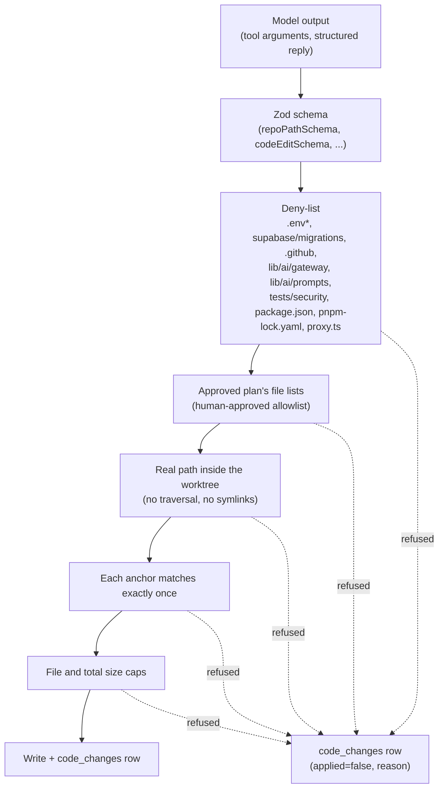

# Product Ops: how the multi-agent workflow works

This document describes the AI Product Ops workflow as built: a LangGraph state
graph whose nodes are the pipeline's stages, two human gates implemented as graph
interrupts, and four tool-using LangChain agents doing the judgement-bearing work
inside those nodes. It is the companion to `.claude/docs/product-ops-spec.md`,
which says what must hold; this says how data moves.

## 1. The shape in one diagram

Three processes touch a run. The browser only ever calls server actions. The
server drives the stages that need no working tree. The CLI worker drives the four
that do, using the same graph with a `Workspace` supplied. All three read and write
the same Postgres rows, and only the gateway ever reaches a model.

## 2. The stage graph

Every edge is the pure `nextStage` function from `domain/product-ops.ts`. No model
ever chooses the next node. A node:

1. checks for its own output first and adopts it if present (idempotency),
2. does its work, agent or deterministic,
3. writes a work event with its cost, then
4. compare-and-sets the run's stage in Postgres. A refused CAS ends the graph with
   `raced`; the checkpoint is a cache of progress and the row is the authority.

The graph checkpoints after every node into `ai_run_checkpoints`, keyed by the run
id as the thread. Killing the process between two nodes loses nothing. Checkpoints
carry identifiers and control flow only; a proposal, a PRD or a plan is always
re-read from its own table.

## 3. What flows through each node

| Node | Owner | Reads | Agent or function | Writes |
| --- | --- | --- | --- | --- |
| research | server | brief | **Research agent**: `search_market`, `record_finding` | `market_research` rows, progress events |
| synthesis | server | findings, prior proposals, corpus | **CPO agent**: `read_findings`, `list_prior_proposals`, `search_internal_docs` | one `product_proposals` row |
| human_review | operator | proposal page | `interrupt()` | `proposal_reviews` row, transition |
| prd | server | approved proposal | `prdSections` structured call + deterministic render | `product_prds` row, `.ai/prds/<id>.md` projection |
| code_plan | worker | PRD, worktree | **Planner agent**: `read_prd`, `list_files`, `read_file`, `search_code` | `implementation_plans` row (denied paths reported) |
| plan_review | operator | plan file lists | `interrupt()`; operator may drop files before approving | plan status `approved`, transition |
| implementation | worker | approved plan, PRD | **Coder agent**: `read_file`, `propose_edit` through the applier | `code_changes` rows, commits on the branch |
| verification | worker | branch | `pnpm verify` through the command allowlist; one coder repair pass on failure | `code_changes` rows for the repair |
| pull_request | worker | proposal, PRD | GitHub client: push, find-or-open PR, label | `pull_requests` row |

## 4. Inside an agent node

The middleware stack, in order:

| Middleware | Bound it enforces |
| --- | --- |
| `runBudgetMiddleware` | The run's euro budget, reconstructed from the run's own events and handed in as the turn. Stops the next model call, not the current one. |
| `toolCallLimitMiddleware` | Per-run cap on tool calls. A loop that keeps calling ends as a typed failure. |
| `modelCallLimitMiddleware` | Per-run cap on model calls, sitting above the tool cap as a second line. |
| `fencedToolResultsMiddleware` | Every tool result is wrapped in its untrusted tag (`web_results`, `market_research`, `repo_source`, `command_output`, `tool_result`) with angle brackets escaped. |
| `progressMiddleware` | Reports each finished tool call: name and success only. Never arguments, never results. |
| `summarizationMiddleware` | Folds older tool output into a summary at 70 percent of the task's input ceiling, using the cheap-tier `productops.context_summary` task. |

The gateway's own ledger callback enforces the same euro ceiling from inside the
model, so the budget middleware is the first line and not the only one.

## 5. What the agents may and may not touch

The planner's `read_file`, `list_files` and `search_code` apply the deny-list before
the filesystem is asked anything, so an agent cannot even read a secret. The coder's
`read_file` goes through the applier and is therefore also limited to the approved
plan. Commands are an allowlist of argument arrays with no shell; the only free-text
argument is a commit message checked by its own rule.

## 6. Human in the loop

Two gates, both graph interrupts, both recorded as `proposal_reviews` rows before the
graph is resumed:

- **human_review**: approve (a PRD follows), reject (run ends as `rejected`),
  reprioritise or comment (recorded, run stays parked).
- **plan_review**: approve the plan, optionally after dropping files from its lists.
  What is approved is exactly what the coder may write. Reject ends the run.

A resume is `graph.invoke(new Command({ resume: decision }))` on the run's thread. If
a run stands at a gate with no checkpoint yet, the action performs the compare-and-set
transition directly and starts the graph fresh, which parks it again at the next gate.
Both paths converge on the same rows.

## 7. Liveness and cost

- Every stage transition and every agent tool call touches `ai_runs.updated_at`. The
  board calls a run stalled only when it has been quiet longer than the slowest stage,
  and polls only while something reports as working.
- Every model call is one `usage_ledger` row tagged with its `productops.*` task, so
  operator spend appears on the existing cost dashboard broken down by task.
- A run's spend is the sum of the `costEur` on its events. Each invocation reconstructs
  it, and a run with nothing left is failed before any model call.

## 8. Where things live

| Concern | Path |
| --- | --- |
| Stage machine, schemas, deny-list | `domain/product-ops.ts` |
| Graph, checkpoint saver, drive/resume | `lib/product-ops/graph/` |
| Agent runtime, middleware, tools | `lib/product-ops/agents/` |
| Agent prompts and tool descriptions | `lib/ai/prompts/product-ops-agents.ts` |
| Task tiers and ceilings | `lib/ai/tasks.ts` |
| LangChain model over the gateway | `lib/ai/gateway/langchain-model.ts` |
| Trusted validation layer | `lib/product-ops/apply.ts` |
| Command allowlist | `lib/product-ops/commands.ts` |
| Worktree, browser, GitHub | `lib/product-ops/workspace.ts`, `lib/github/client.ts` |
| Repository over the eleven tables | `repositories/product-ops-repository.ts` |
| Operator pages and actions | `app/(app)/operations/product/` |
| CLI worker | `scripts/product-implement.ts` |
