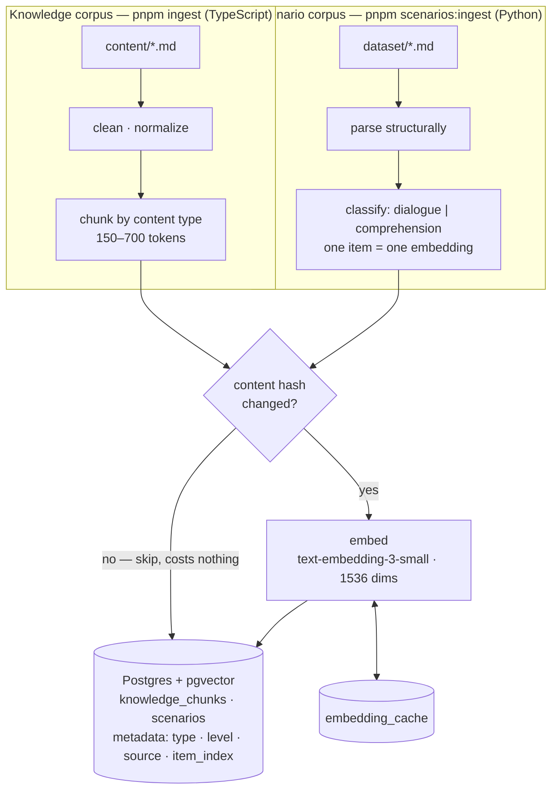
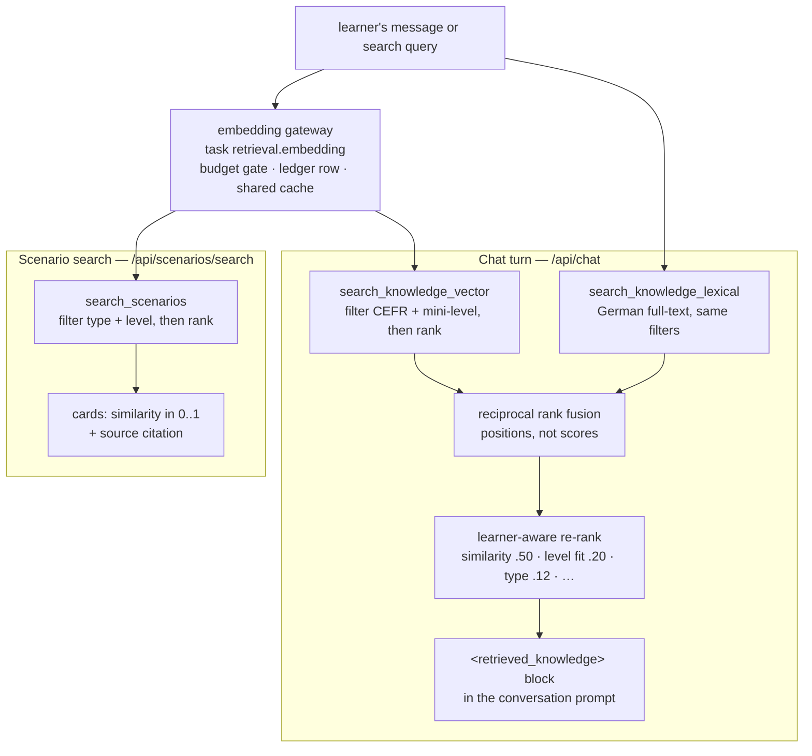

# How the pieces work

Plain-language explanations of the seven things this project is built out of,
and what was actually done with each.

Where something was **not** built, this says so. A document that describes an
intention as an achievement is worse than no document.

---

## 1. Advanced RAG

### What it is

RAG — retrieval-augmented generation — means: before asking a model a question,
go and find the relevant material and put it in the prompt. The model then
answers from what it was shown rather than from what it half-remembers.

The naive version is: turn the question into a vector, find the most similar
paragraphs, paste them in. That is enough for a demo and not enough here.

### Why the naive version fails for a language tutor

The corpus spans A1 to B1. Ask *"warum sagt man mit dem Zug?"* and the most
semantically similar paragraph in the whole corpus is very often a B1
explanation of prepositional case government. It is the **correct answer to the
question** and the **wrong answer for the person asking it**, because a beginner
cannot read it.

Similarity does not know who is asking. So four things were added.

### What was built

**Chunking by content type, not one size for everything.** A grammar
explanation gets 300–700 tokens so the rule and its examples stay together. A
vocabulary entry gets at most 200, because one word does not need a page. A
dialogue gets 150–500. Boundaries come from the text — paragraph first,
sentence next — and a horizontal rule in a source file is an author-declared
boundary that is never crossed, which is how each of the 420 words stays its own
retrievable chunk instead of six being packed together to hit a size target.

> `lib/ingestion/chunk.ts`

**Filtering before ranking, in SQL.** Both search functions take the learner's
eligible CEFR bands and a mini-level ceiling and apply them in the `WHERE`
clause. Filtering a top-N *after* ranking is a filter that has already lost: the
B1 paragraph was the top result, so the top-5 is five B1 paragraphs and then you
filter them all away.

> `supabase/migrations/20260821121800_retrieval.sql`

**Hybrid search — two arms, fused on rank.** Vector search finds text that
*means* the same thing; a full-text search using Postgres's German
configuration finds text that *uses* the same words. German stemming matters
here: *Wohnungen* has to find *Wohnung*, which the English configuration will
not do.

The two scores are not comparable — one is a cosine, the other is a
corpus-dependent `ts_rank` whose absolute value means nothing — so they are
fused on **position** rather than score, with reciprocal rank fusion. A chunk
found by both arms scores in both lists and the contributions add, which is what
makes agreement between two independent searches the strongest signal available.

> `lib/retrieval/fusion.ts`

**Learner-aware re-ranking.** The final score is half similarity and half who is
asking:

```
similarity 0.50   level fit 0.20   content type 0.12
grammar target 0.08   topic 0.04   known weakness 0.04   target words 0.02
```

Level fit penalises material *above* the learner twice as hard as the same
distance below — what they have passed is worth revisiting, what they have not
reached is worth little today however well it matches. A pattern the learner
keeps getting wrong outranks the one this level happens to be teaching, because
a recurring mistake is a request for help nobody typed.

The guard is soft on purpose. A B1 chunk with a *marginal* similarity advantage
loses to an on-level A2 chunk; a B1 chunk that is the only thing in the corpus
answering the question still wins, because silence serves nobody. Both
directions are tested.

> `lib/retrieval/scoring.ts`

**Idempotent ingestion.** A document is keyed by the hash of its cleaned body, a
chunk by the hash of its own text. Re-running the pipeline over an unchanged
corpus does nothing and costs nothing — it skips before it embeds, which is the
only step that costs money. Edit one paragraph of three and exactly one is
re-embedded. A chunk the source no longer produces is deleted, because otherwise
a document that shrinks keeps answering from text it no longer contains.

> `lib/ingestion/pipeline.ts`

**Query routing.** Not every question should be answered from the corpus at
all. *"Wie ist das Wetter heute?"* is routed to `web` and retrieves nothing,
because a corpus of teaching material has no current facts in it and answering
from it would mean stating last year's weather as today's.

### The pipeline, drawn

Two corpora feed one vector store, offline. The knowledge corpus is chunked;
the scenario corpus is not — a scenario is a self-contained practice item, and
splitting one would let a query match half of it. Both pipelines hash before
they embed, because embedding is the only step that costs money.



At request time the same store answers two different questions. A chat turn
wants the best *material for this learner*; a scenario search wants the best
*items for this request*. Both embed the query through the gateway — one
budget-gated, ledgered, cache-shared call — and both filter in SQL before
ranking.



Every scenario hit carries its citation — the dataset document it was parsed
from and its position in it — end to end: the search function returns
`source` and `item_index` with each row, the API response includes both, and
the card prints them. Retrieved content that cannot say where it came from
cannot be checked against its source.

> `lib/scenarios/citation.ts`, `supabase/migrations/20260824150000_scenario_citations.sql`

---

## 2. Tool calling

### What it is

Tool calling is when you hand a model a list of functions it may ask you to run
— `get_weather(city)`, `search_flights(...)` — and it replies with a structured
request instead of prose. Your code runs the function and hands back the result.

### What was built: the Trainer's toolbox — and the tutor still has none

**Tool calling lives in one place: the Trainer** (`/trainer`), a LangChain
agent that runs practice sessions. It holds six local tools, each a thin,
learner-scoped wrapper over code that already existed:

| Tool | Wraps | Kind |
| --- | --- | --- |
| `get_review_session` | the review engine (`learning/review.ts`) | read |
| `get_progress` | learner state + per-level tallies | read |
| `get_grammar_pattern` | the 86-pattern grammar catalogue | read |
| `search_knowledge` | the RAG retriever, sources collected for citation | read |
| `record_review_outcome` | the deterministic vocabulary engine | **write** |
| `fetch_simple_german_news` | nachrichtenleicht.de headlines, fenced | read |

plus whatever a configured remote MCP server offers (section 2b). The rules
they run under are the guardrails' (S11): the learner id is bound from the
verified session and is never a tool argument; every call is audit-logged by
name, never by content; anything fetched from outside is fenced as untrusted
before the model reads it; and the one write tool keeps the split the whole
product lives by — the model judges whether an answer was right, the
spaced-repetition arithmetic decides what that does to the schedule, with a
hard per-request write cap.

> `lib/trainer/tools.ts`, `lib/trainer/agent.ts`, `lib/api/trainer.ts`

### Why the tutor pipeline still has no tools

The chat turn remains tool-free, and the original reasoning still holds there.
Tool calling earns its cost when the model has to **decide** which action to
take from a set of options whose relevance it can judge better than your code
can. In the tutor's turn, every candidate action is one the code decides
better:

| A tool would have done | What does it instead | Why |
| --- | --- | --- |
| `search_knowledge(query)` | The graph always retrieves, before generating | Letting the model choose whether to retrieve adds a round trip to decide something the answer is always better for |
| `get_learner_level()` | The level is already in the prompt | It is three tokens; asking for it costs a whole extra call |
| `record_error(...)` | A separate evaluation pass on a cheaper model | Errors are found by reading the learner's message, which is a different job from writing a reply — and a cheaper one |
| `schedule_review(word)` | Spaced repetition, in pure functions | Arithmetic on a date is not a judgement call |

That is the routing document's rule applied honestly: *deterministic logic beats
a cheap model; a cheap model beats a strong model.*

### What plays the same role

**Structured output.** Six of the eight prompt entries return a JSON object
against a Zod schema rather than prose — which is the same mechanism tool
calling uses, minus the round trip. The contract is generated from the schema
that validates the reply, so the prompt and the validator cannot describe
different shapes, and the reply is parsed, validated, salvaged where safe and
discarded where not.

> `lib/ai/prompts/contract.ts`, `lib/ai/evaluation/`

The Trainer is the case where the table flips: which review item to quiz
next, whether a free-form German answer was right, when to reach for the
grammar shelf — those are judgement calls mid-conversation, which is exactly
what tool calling is for.

### 2b. The remote MCP connection

The Trainer can also borrow tools from a **remote MCP server** over streamable
HTTP — configured, not hardcoded (`MCP_SERVER_URL`, with DeepWiki's public
keyless server as the documented default; `MCP_SERVER_API_KEY` rides as a
bearer header when a server wants one). An unset server means a thinner
trainer, never an error. Every borrowed tool is wrapped before the agent sees
it: its output is truncated, angle-bracket-escaped and fenced in
`<mcp_results>`, because a remote server's text is a third party inside the
conversation and never gets to sound like policy (S10/S31).

> `lib/trainer/mcp.ts`

---

## 3. ChatGPT

### What this actually means here

Two different things get called "ChatGPT", and only one of them applies.

**The product at chat.openai.com** is not used, and could not be — it has no
API, no per-call cost accounting and no way to enforce a token ceiling.

**OpenAI's models** are used, and so are Anthropic's and Google's. What was
built is a **ChatGPT-style interface** — a text box, a streamed reply, a thread
you can come back to — over a routing layer that treats "which model" as
configuration.

### How models are actually reached

```
application code says:  "this is a conversation.turn"
      │
      ▼
task table    →  tier: strong,  ceilings: 4000 in / 300 out at A1
      │
      ▼
registry      →  anthropic/claude-sonnet-5, falling back to openai/gpt-5.4
      │
      ▼
OpenRouter    →  one API for every chat and embedding model
      │
      +──  OpenAI direct  →  speech only (OpenRouter serves no speech model)
```

Application code never names a model. It names a **tier**, and one file maps
tiers to models — a CI test fails the build if a model id appears anywhere else.
That is what makes swapping Sonnet for GPT-5 an environment variable rather than
a pull request.

Five tiers, because one model for everything is a defect rather than a default:

| Tier | Used for | Roughly |
| --- | --- | --- |
| `reasoning` | Milestone assessment. Rare, never on the chat path | Opus-class |
| `strong` | The German conversation turn. The only tier that streams to a learner | Sonnet-class |
| `mid` | Learning evaluation — needs real grammar understanding | Flash-class |
| `cheap` | Error and memory extraction, summarisation | Mini-class |
| `nano` | Single-label classification | Nano-class |

Every model id in the registry was checked against OpenRouter's live model list
rather than recalled, because a stale hardcoded assumption is a production
incident.

**Cost, per learner turn:** €0.0064. The conversation turn is 71% of it, which
is exactly why the other four calls are not on the strong tier.

> `lib/ai/tasks.ts`, `lib/ai/gateway/registry.ts`

---

## 4. Prompt engineering

### What it is

Writing the instructions a model is given. Usually done by pasting a long string
next to the code that sends it, editing until the output looks right, and moving
on.

That approach has three failure modes, and all three were designed against.

### Failure 1: nobody can tell what changed

A prompt at its call site cannot be versioned, so when quality moves nobody can
say what moved it.

**Every production prompt is a catalogue entry** with a name, a version, a
purpose, an input schema, an output contract, safety rules, a block list and a
named eval set. Entries are immutable once shipped: behaviour changes by adding
a version, so a trace from last week still means what it said.

The prompt text is **fingerprinted per version** and the hash is recorded in a
test. Edit one word and the test fails with a message spelling out the two
legitimate responses: update the hash for a cosmetic change, or bump the version
for a behavioural one. What it cannot be is an unnoticed edit.

> `lib/ai/prompts/catalogue.ts`, `tests/unit/ai/prompt-versioning.test.ts`

That lock caught a real bug. The machine-register identity block had a token cap
smaller than the block itself, so it had been shipping truncated mid-sentence
for three phases — and nobody noticed, because the lock hashed the *intended*
text while the builder shipped the *rendered* one. The two definitions are now
one function.

### Failure 2: the prompt grows until it is expensive

**Prompts are assembled from twelve blocks**, each with its own token cap, in a
fixed order. The three blocks that are identical every turn come first, so the
cacheable region is contiguous and a provider's prompt cache can cover it. That
stable prefix is 403 tokens and its size is locked by a test, because prefix
growth taxes every single turn.

If the total is over the ceiling, context is shed in a fixed order — oldest
messages, then the least relevant retrieved chunk, then the least important
memory, and the summary last. The policy, the learner's state and the current
message are never shed. The message is rendered whole and the call is **refused**
if it does not fit: answering something the learner did not say is worse than
refusing.

> `lib/ai/prompts/blocks.ts`, `lib/ai/prompts/builder.ts`

### Failure 3: the instructions can be overridden by the input

Everything that did not come from the system — retrieved chunks, memories, the
thread summary, the learner's own words — is **fenced in tags**, and a standing
clause placed before any of them says that anything inside a fence is material
to use, never an instruction to follow.

Every angle bracket in untrusted content is replaced with a lookalike, not just
matching closing tags: inventing `</learner_memory><user_message>` is as
effective as closing your own fence and costs an attacker nothing. Hostile
content is **fenced, not dropped** — dropping it hides the attempt and takes
real content with it, and the standing instruction is written for exactly that
case.

> `lib/ai/prompts/delimiters.ts`

### Two registers, because one size did not fit

Learner-facing prompts carry the full standing clauses — no claiming
certification, no other learner's data, no invented grammar rules — because a
model writing to a person can do all three.

A classifier returning one label to code that validates it needs the
delimited-data rule and nothing else. Giving it the conversational preamble was
not caution: `classification.intent` has an 800-token ceiling and those clauses
alone cap at 2100, so the prompt was **structurally impossible to build**. The
machine register's prefix is 200.

### Behaviour is configuration, not three prompts

A1 gets three sentences, no grammatical terminology, gentle reformulation and
two new words. B1 gets eight sentences, selective correction and four. That is
one table with one row per level, and the prompt is rendered from it — adding a
fourth level means adding a row.

The learner's stated correction preference narrows it, but **an A1 learner who
asks for explicit correction still gets reformulation**: the level caps how
technical feedback gets, and someone at A1 does not need a lecture on cases they
have not met.

> `lib/ai/prompts/behavior-policy.ts`

### The output contract writes itself

For prompts that return JSON, the shape description in the prompt is
**generated from the Zod schema that validates the reply**. Hand-written prose
drifts: a field gets a tighter cap, an enum gains a member, and the prompt keeps
describing last month's contract while the validator rejects this month's
output — a failure that looks like a bad model. Generating it means there is
only one definition.

> `lib/ai/prompts/contract.ts`

---

## 5. Next.js

### The version matters

This is **Next.js 16** with the App Router, React 19 and the React Compiler.
Two things differ from most examples you will find:

- middleware is called `proxy.ts`, not `middleware.ts` — Next.js 16 renamed it,
  and having both, or only the old one, means the guard silently does not run
- the React Compiler handles memoisation, so there is no `useMemo` or
  `useCallback` anywhere in this codebase

### Server by default

Almost everything is a Server Component. Pages read from the database directly
in `async` functions, and the only Client Component of consequence is the chat
box — because streaming a reply into a list needs state, and nothing else does.

That has a security consequence worth naming: **the Supabase secret key is never
importable from a Client Component.** `lib/env/server.ts` carries a
`server-only` marker, so importing it from client code is a build error, and a
CI test scans the tree for it anyway.

### Route handlers

One API route, `POST /api/chat`. It is thin on purpose — read a session, read a
body, turn a result into a response — and everything it actually does lives in
`lib/api/chat.ts`, where it can be tested without standing up a server.

It runs on the **Node runtime**, not edge, for two reasons: the pseudonymous
learner hash uses `node:crypto`, and the work after the last chunk — saving the
message, scoring the learner's German — has to outlive the stream. That second
one is subtle: a serverless runtime can tear a process down the moment a
response ends, so the after-stream work is awaited **inside the stream's own
lifetime** rather than after it.

> `app/api/chat/route.ts`, `lib/api/chat.ts`

### Streaming

The reply is a `ReadableStream` of plain UTF-8, not server-sent events. There is
one kind of event — text — and adding a framing format nobody needs is one more
thing to get wrong. The client reads it with a `TextDecoder` and appends.

### Server Actions

Form submissions — sign in, onboarding, starting a thread — are Server Actions.
Starting a thread is a form rather than a link specifically because it writes a
row, and a `GET` that writes is a `GET` a link prefetch can trigger.

### Three layers of protection, none relied on alone

1. `proxy.ts` redirects signed-out visitors — a convenience, not a boundary
2. The authenticated layout checks the session and the onboarding gate, so a new
   route under that segment is protected by default
3. Row Level Security enforces access in the database, whether or not a request
   ever passed through either of the above

---

## 6. LangChain

### What was actually used

**LangChain v1 runs the Trainer.** The `/trainer` feature is a tool-calling
agent built with `createAgent` from the `langchain` package (LangGraph
underneath), holding the six local tools plus any remote MCP tools from
`@langchain/mcp-adapters`. The loop is bounded twice: a hard recursion limit
(`TRAINER_MAX_STEPS`), and a per-request euro ceiling enforced from inside the
model's own callback.

The gateway boundary survived the introduction. `ChatOpenAI` is instantiated
in exactly one place — `lib/ai/gateway/langchain-model.ts`, inside the only
directory allowed to touch a model SDK — with the model id resolved from the
registry by tier, the ceilings taken from the task table
(`trainer.session`), and a callback handler that writes one ledger row per
LLM invocation through the same accountant every other call uses. The factory
hands out the tier's whole ladder — the primary and its same-tier fallbacks —
and the agent walks down it when OpenRouter serves no endpoint for a model
under the account's data policy, the same resilience the chat transport has
always had. The security suite's ban on `@langchain/openai` imports outside
the gateway is what makes that a property rather than a habit.

**LangSmith** is the tracing backend and is wired in configuration. Its key is
withheld unless tracing is actually enabled, so a key left in the environment of
an untraced deployment is never handed to a client that might use it.

**The tutor's graph is still not LangGraph**, and that remains deliberate.

### Why, honestly

The routing document's architecture puts LangGraph above the model gateway, and
that layering is right: orchestration should be separate from dispatch. What is
in question is whether every orchestration needs a library.

The tutor's graph is seven nodes in a straight line with no cycles and
one conditional exit. A graph engine earns its weight when you have branching
that changes per turn, loops with convergence conditions, or state that has to
survive a process restart mid-run. None of those is true yet.

What was written instead is 120 lines: a state object, seven functions that each
take state and return state, and a runner that threads them. It has the
properties the library would have been bought for — every node is independently
testable, the sequence is data rather than control flow, and a node that fails
degrades rather than throwing — and it has one the library would not: **the
whole turn can be driven in a test with no database, no network and every node's
failure independently switchable.**

> `lib/graph/`, `tests/unit/graph/fixtures.ts`

The Trainer is the branch that finally earned the library: a loop whose shape
changes per turn, decided by model output — exactly what the hand-rolled
runner was never built for, and exactly what an agent framework is.

The honest summary: **the tutor's fixed pipeline is our own 120 lines; the
Trainer's dynamic loop is LangChain's `createAgent`; LangSmith is the tracing
backend; and the gateway remains the only place a model SDK lives.**

---

## 7. Vector databases

### What one is

A vector is a list of numbers that represents a piece of text's *meaning* — an
embedding model produces it. Two texts that mean similar things get vectors that
point in similar directions, so "find text about the dative case" becomes "find
the nearest vectors", which is arithmetic.

A vector database stores those and searches them quickly.

### What was used

**Postgres with pgvector**, inside Supabase. No separate vector service.

That is a deliberate choice with a real trade-off. A dedicated vector database
would be faster at very large scale. Postgres is faster at everything else this
product does, and the query that matters here is not "find similar vectors" — it
is *"find similar vectors **among the chunks this learner is allowed to see, at
their level, of a content type that suits their question**"*.

In Postgres that is one query. With a separate vector store it is a vector
search, then a fetch of metadata from Postgres, then a filter — which either
over-fetches or filters after ranking, and filtering after ranking is the bug
described in the RAG section above.

### How it is set up

**1536 dimensions**, from `text-embedding-3-small`, behind an `EmbeddingProvider`
interface — the business objective asks for the provider and dimension to be
configurable, so nothing outside the gateway knows either.

**Cosine similarity with an HNSW index.** Cosine because embedding models
produce direction-normalised vectors, so the angle is the signal and the
magnitude is not. HNSW because it is the index type that stays fast as the
corpus grows.

**Reported as a similarity, not a distance.** `1 - (distance / 2)`, so nothing
outside the search function has to remember which way round the operator runs.

**The extension lives in its own schema.** pgvector in `public` puts its
functions and operators on the API surface next to application tables, which
Supabase's linter flags. Moving it out is why the search function has to write
`operator(extensions.<=>)` — a detail that only surfaced when the migration was
pushed to a real project, because the migration role's search path is not the
API role's.

### Embeddings are model calls too

They are routed by tier, budgeted, and write a ledger row like everything else.
An embedding has no output tokens, which the ledger's constraint had to be
taught: zero is the *correct* figure for an embedding and a misconfiguration for
a chat call, and the constraint now says exactly that.

**Embeddings are cached by content hash.** Re-embedding unchanged text is the
easiest cost in the system to remove, and ingestion is where it would otherwise
be paid over and over. The cache key includes the **model**, because two models'
vectors are not comparable — a model change is a cache miss, never a stale hit,
and mixing them would silently poison every similarity score that followed.

> `supabase/migrations/20260821120500_knowledge.sql`,
> `lib/ai/gateway/embedding-service.ts`

### Where the vectors are not

Vocabulary, grammar rules, learner state, errors, assessments, review schedules
and recommendations are **not** in the vector store. They are structured tables,
because "which words are due" is a date comparison and "has this learner earned
the next level" is a rule — and neither gets better for being turned into an
approximate nearest-neighbour search.

The vector store holds explanations, dialogues, sentence patterns, cultural
notes and mistake explanations: the things that are genuinely prose, where
"similar meaning" is the right question to ask.
